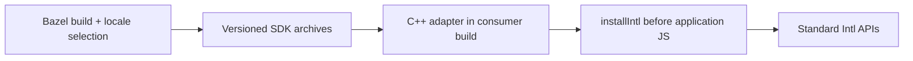

# Hermes SDK distribution

`native/hermes/package` owns SDK assembly, CMake integration, and contrib glue.
`formatjs/hermes-intl` is the Android example, not another packaging implementation.
Public installation docs live at `docs/src/docs/guides/hermes-intl.mdx`.

- `:sdk`: Linux x86_64 GNU + macOS arm64/x86_64 Rust archives.
- `:android_sdk`: arm64 + x86_64 Android archives, NDK 27.1.12297006.
- `:apple_sdk`: iOS arm64, iOS simulator arm64/x86_64, macOS arm64/x86_64.
  Cross-build on Linux with `--config=bb-cross-build`; iOS minimum 15.1.
  Linux LLVM tools compile the header-free Rust allocator shim; no iOS SDK is
  needed to produce Rust archives. Full Xcode remains necessary for final
  consumer linking, which runs against the prebuilt archive on macOS.
- All include identical headers/adapters/setup JS, notices, optional calendar
  and timezone resources. Consumers compile adapters against their own JSI.
- All archive transitions use optimized Rust and ThinLTO. Locale selection is
  `--//crates/intl_data:locales=`; default Chromium desktop language filter,
  explicit list or `*`. Segmenter/Collator/Locale static data is unchanged.

`formatjs::installIntl(runtime[, extensions])` replaces all twelve Intl APIs once
per runtime. The setup-object overload works with Hermes extension bytecode.
The source overload evaluates the same bundle. One runtime-data owner retains
DateTimeFormat state. Prepare supportedValuesOf before Locale captures it; finish
its formatter observation after all constructors exist. Individual installers
remain available. Contrib delegates to this entry point.

`cmake/FormatJSIntl.cmake` adds sources and native archive to an existing target.
Apple consumers select one architecture per build; CMake honors
`CMAKE_OSX_ARCHITECTURES` and distinguishes iOS device/simulator sysroots.
Its optional second target separates Hermes' object compilation from final link.
The SDK's Bazel module retains its original name for compatibility; `:intl`
links all adapters. The independent Bazel consumer verifies the extracted layout.

Release Please owns the SDK component at `native/hermes`, independently of Rust
crate versions. `version.txt` is authoritative; its generic updater keeps the SDK
MODULE version aligned. `.github/workflows/hermes-intl-release.yml` builds all three
Bazel packages on SDK release publication, uploads stable archive filenames and
SHA-256 checksums, and preserves Release Please notes. Manual runs default to
build-only. BuildBuddy produces the Apple archive alongside desktop artifacts
for PRs. Native Smoke Tests download it, link all five slices through the standalone
`examples/hermes-apple-sdk` Bazel consumer, verify executable platform metadata,
and run the host-macOS executable. Mac validation compiles no Rust or locale data.
The release workflow uses the same Linux producer/macOS consumer split. First release must land before docs' download path is usable.

