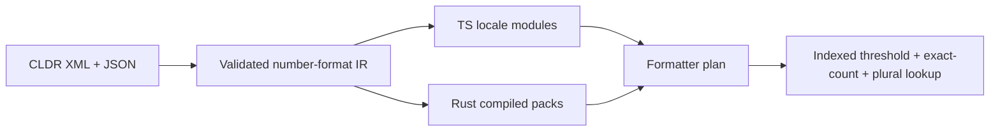

# NumberFormat audit, 2026-10-31

Baseline: `270fc371b1b88ee26d4649b06272bd8536082b14`. Scope: TS NumberFormat,
Rust formatting core, Hermes boundary parity, CLDR extraction, locale negotiation,
and independent ICU formatting oracles. This is an audit plus a performance
prototype. Correctness findings below remain open.

## Evidence and scope

- Five baseline Bazel targets pass: TS tests, Test262, Rust tests, pack validation,
  and Rust/TS conformance. Hermes source/bytecode parity also passes with the prototype.
- Test262 executes 498 variants: 490 pass, eight tracked failures. Six concern
  normative-optional legacy construction; two concern cross-realm constructor
  prototype fallback. A green baseline target does not mean zero failures.
- Independent matrix: 35,629 distinct cases, all 657 generated locale packs,
  all 78 ICU numeric numbering systems, 17 representative locales for the larger
  option/range matrix, seven ICU rounding modes, precision priorities, exact
  decimal strings, nonfinite values, and ranges. Java output includes parts;
  C output independently checks text. Public JS coercion/branding is covered by
  Test262 and Hermes tests, rather than simulated by ICU's APIs.
- ICU4C and ICU4J are separately pinned to **79.1 / CLDR 49**. Existing repository
  ICU 78.1 suites remain unchanged. Node 24.14.0 / ICU 78.2 is recorded as a
  secondary reference, not a version-aligned golden oracle.
- ICU4J 79.1 emits malformed UTF-16 for supplementary numbering systems with
  multi-digit scientific exponents. The generator explicitly excludes 120 such
  cases and rejects any other malformed strings. Example: Adlam scientific
  `1e21` produces unpaired surrogates. These exclusions are oracle limitations,
  not accepted product failures.
- ICU C/J text disagrees on 121 rows: 119 rows across eleven locale variants and
  two Arabic large-number unit plurals. Both results remain in the report.
  Same release number does not guarantee identical oracle behavior/data coverage.
- Primary J comparison finds **2,830 differing cases per implementation**:
  637 single-value text, 886 single-value parts-only, 1,125 range text, and 182
  range parts-only. C text differs on 638 singles and 1,125 ranges. These are
  differences, not 2,830 specification violations: many concern permitted locale
  formatting, bidi segmentation, grammar/collapse conventions, or oracle defects.

The oracle adapter applies ECMA's formatted-string identity rule before ICU range
formatting, including signed zero hidden by `signDisplay`. It forces approximate
identity output instead of ICU's default exact-input single-value fallback.

## Findings

### P1: range collapse can erase endpoint signs

Both implementations produce the same string for different ranges:

```js
const nf = new NumberFormat('en', {
  style: 'unit',
  unit: 'meter',
  unitDisplay: 'long',
})
nf.formatRange(-3, -2) // "-3–2 meters"
nf.formatRange(-3, 2) // "-3–2 meters"
```

Currency names have the same collision: `-3.00–2.00 US dollars`. The uncollapsed
endpoint strings differ. This violates the ambiguity constraint in
[ECMA-402 CollapseNumberRange](https://tc39.es/ecma402/#sec-collapsenumberrange).
The range code shares minus signs when a suffix is shared. Its code-point-length
heuristic also treats a bidi mark plus sign as a multi-character affix; the audit
contains plain Arabic/Hebrew/Persian decimal probes for this case.

Sources: `packages/ecma402-abstract/NumberFormat/CollapseNumberRange.ts`,
`crates/intl_numberformat/range.rs`. First fix: preserve endpoint sign modifiers.
Returning the uncollapsed range is a valid fallback.

### P1: accounting modifiers are split apart

```js
new NumberFormat('en', {
  style: 'currency',
  currency: 'USD',
  currencySign: 'accounting',
}).formatRange(-2, -1) // "($2.00) – 1.00)"
```

Prefix and suffix collapse independently. Opening parentheses/currency disappear
from one endpoint while closing parentheses remain. Model the entire accounting
modifier as a pair, or retain both complete endpoint patterns.

### P2: plural selection discards exact decimal information

Both implementations convert a rounded mathematical value through a floating
point Number before selecting its plural category. Polish meter formatting of
`"9007199254740993.125"` preserves the digits but uses `metry`; both ICU oracles
use fractional `metra`. Rust's `category()` explicitly mirrors the TS conversion.

Separately, internal plural selection reapplies digit defaults and loses
`trailingZeroDisplay`: English long meter with `minimumFractionDigits:2` and
`trailingZeroDisplay:'stripIfInteger'` formats `1` as **`1 meters`**. Russian,
Polish, Czech and Hebrew also show wrong forms after stripping zeros.

Keep the already-rendered decimal string, visible fraction counts, and compact
exponent together. Select cardinal rules from those operands; avoid converting
back through Number or rounding them again. Existing Rust plural programs and TS
operand/rule infrastructure provide a starting point.

### P2: CLDR exact-count compact overrides are discarded

Pinned CLDR 49 `fr.xml` has `count="1"` → `mille` at threshold 1000. Both extractors
iterate only six plural categories, dropping that override. French long compact
`999.5` rounds to **`1 millier`**, while ICU produces **`mille`**.

Sources: `scripts/extract-numbers.ts` and
`scripts/number-data/numbering-system-data.ts`. Preserve exact-count overrides
separately from plural categories. Literal-only overrides must be valid templates;
today's formatters assume a numeric placeholder always exists.

### P2: numeric compact grouping and currency spacing are simplified

- Compact formatting disables grouping unconditionally. English `1e21` gives
  `1000000000T`, whereas ICU gives `1,000,000,000T`.
- Currency spacing tests only the currency label. It ignores the surrounding-digit
  condition, inserting NBSP beside NaN/infinity: `BHD NaN` versus ICU `BHDNaN`.
- Many parts-only differences put bidi marks inside `minusSign`/`plusSign`, whereas
  ICU emits separate literals. These need a documented parts policy, not blind
  snapshot replacement.

### Performance: existing matcher cache is bypassed

`InitializeNumberFormat` calls `ResolveLocale(Array.from(availableLocales), ...)`.
The new array defeats the supported-locale cache keyed by input identity. Passing
the stable Set reuses the matcher's existing mutation-aware cache. This relies on
Set support already published in `@formatjs/intl-localematcher` 0.10.0.

NumberFormat has no DateTimeFormat-style pattern search. The relevant work is
locale negotiation, compact-threshold/plural selection, and CLDR pattern parsing.

## Measured prototype

One host, optimized Bazel builds, Node 24.14.0, seven rounds of 12,000 format calls;
constructor rounds contain 1,000 calls. Full locale loading registers 976 matching
labels. Timings are warm medians in microseconds, not mobile or Hermes end-to-end
latency. Output checksums match before/after.

| TS workload                              | Baseline | Prototype | Result                |
| ---------------------------------------- | -------: | --------: | --------------------- |
| Decimal formatting                       |    5.822 |     3.010 | 1.93x faster          |
| Currency formatting                      |    6.110 |     3.217 | 1.90x faster          |
| Long-unit formatting                     |    6.433 |     3.692 | 1.74x faster          |
| Scientific formatting                    |    6.166 |     6.186 | effectively unchanged |
| Compact formatting                       |   15.024 |    14.345 | 1.05x faster          |
| Compact currency                         |   15.209 |    14.607 | 1.04x faster          |
| Exact-English construction               |    4.872 |     8.776 | 3.904 µs slower       |
| Best-fit fallback construction (`de-XX`) |  672.512 |     9.874 | 68.11x faster         |
| Lookup fallback construction             |   16.143 |     4.768 | 3.39x faster          |

Prototype changes: retain locale-set identity; skip redundant exponent preview
rounding for standard notation; cache compact magnitudes/exponents numerically
once per pattern table. Compact indexes are lazy, invalidated on locale
re-registration, and shared by numbering-system aliases. They do not change the
serialized locale format or mutate caller payloads. Tests cover reversed threshold
insertion order, same-payload re-registration, and registration after a cached
locale fallback.

The exact-English construction tradeoff comes from checking the complete mutable
registry before reusing a cache. Cold load/register timings include filesystem
reads and JSON parsing and varied across runs; no cold-start improvement claim.
A native Rust compact-index prototype had no repeatable gain and was reverted.
The optimized Rust benchmark remains available; TS gains do not imply equivalent
native/Hermes gains. The performance prototype preserves the existing correctness
findings; it does not certify ICU conformance.

## Data-processing direction



Proposed IR should preserve numeric magnitude/scale, exact-count overrides,
cardinal/plural-range programs, grouping intervals and minimum digits, parsed
positive/negative/accounting modifier pairs, and currency-spacing predicates.
Keep source/version/inheritance provenance. Parse and validate CLDR syntax once;
choose semantic records at runtime. Retain a legacy raw-data adapter for existing
`__addLocaleData` callers. The complete IR is a proposed follow-up, not implemented
by this prototype.

Order: fix sign/accounting range correctness; preserve exact plural operands and
compact overrides; then compile reusable token/modifier plans. Maintain independent
ICU checks alongside Rust/TS parity, with explicit handling of oracle disagreement.

## Reproduction

```sh
bazel test -c opt //packages/intl-numberformat:test262 \
  //packages/intl-numberformat:intl-numberformat_test \
  //crates/intl_numberformat:intl_numberformat_test \
  //crates/intl_numberformat/tests:conformance_test \
  //native/hermes/tests:numberformat_conformance_test
bazel run -c opt //packages/intl-numberformat/benchmark:audit -- --all-locales
bazel run -c opt //crates/intl_numberformat:benchmark
bazel run -c opt //crates/intl_numberformat/tests:icu_audit -- --output=/tmp/numberformat-audit.json
```

For the second oracle, build
`//conformance-tests/icu4c:number_format_fixtures` on Linux/RBE, resolve its output
with `bazel cquery --output=files`, and pass that path as `--icu4c=<file>` to the
audit. The C oracle action uses Ubuntu 24.04 to match the upstream ICU binary.
`--strict` makes the audit exit nonzero for recorded differences; default mode
writes the complete inventory without treating known differences as passing
conformance. Do not blanket-allowlist them or update product snapshots to match an
oracle without checking specification and CLDR behavior.
