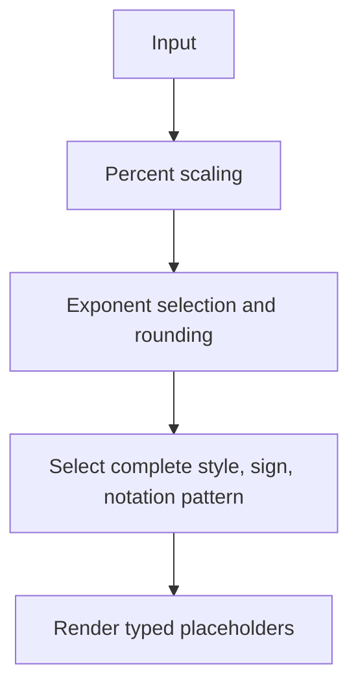

# Draft: compact NumberFormat pattern composition

Submitted as [tc39/ecma402#1117](https://github.com/tc39/ecma402/pull/1117).
The PR implements sections 1–2, preserves existing numberless compact templates,
and passes the strict spec build. Section 3 remains separate. No TC39 acceptance
or engine implementation is implied.
Addresses [ecma402#439](https://github.com/tc39/ecma402/issues/439), including
notation-dependent percent placement. Exact-count selection is a related,
separable extension below. No new JavaScript API.

Baseline: [ECMA-402 numberformat.html at af194df](https://github.com/tc39/ecma402/blob/af194df3c8633510a6c5982e8dbdb00cb3b6105f/spec/numberformat.html).
Source analysis and reproductions: [compact-percent audit](2026-11-14-compact-percent-icu-spec.md).

## 1. Select complete compact patterns

Current composition fixes the style/sign envelope before inserting unsigned
compact notation. Instead, select one complete compact pattern using style,
display options, sign category, and exponent. Keep existing rounding and sign
category computation.



Add `[[compactPatterns]]` to each locale's data. Its style, currency, unit,
display, and sign branches mirror `[[patterns]]`. Each sign leaf contains
exponent-indexed complete patterns. Exponent zero supplies the non-abbreviated
compact-mode pattern, including for NaN and infinities.

Complete compact patterns may interleave number, compact, sign, currency, unit,
and percent placeholders. Retain the existing style-specific requirements for
percent/currency/unit markers and existing sign selection. Compact markers are
permitted in the complete pattern itself. Existing numberless templates remain
allowed for nonzero exponents; exponent zero requires the digit placeholder.

These are conceptual algorithm diffs; field validation and ecmarkup edits remain
to be written:

```diff
- GetNumberFormatPattern(numberFormat, x)
+ GetNumberFormatPattern(numberFormat, x, exponent)

  Let patterns be numberFormat.[[LocaleData]].[[patterns]].
+ If numberFormat.[[Notation]] is "compact", then
+   Set patterns to numberFormat.[[LocaleData]].[[compactPatterns]].

  [Existing style, currency/unit display, and sign selection.]
+ If numberFormat.[[Notation]] is "compact", then
+   Select the entry for exponent from the selected sign leaf.
  Return the selected pattern.
```

In `PartitionNumberPattern`, pass the already-computed exponent to this operation.
Handle `compactSymbol` and `compactName` alongside the existing style/sign
placeholders, using their current semantic part type, `compact`.

In `GetNotationSubPattern`, remove compact lookup. Compact digit insertion now
uses `{number}`; scientific/engineering handling stays in that operation.
This prevents nesting a second compact pattern inside the complete pattern.

`ComputeExponentForMagnitude` must select its compact scaling data using the
same style/display options as the complete-pattern lookup. Its existing
rounding-carry retry remains. A selected pattern and its exponent must describe
the same scale.

## 2. Permit notation-dependent percent representations

Replace percent-sign resolution's notation-independent symbol selection with:

> Let percentSignSymbol be an implementation-, locale-, and numbering-system-
> dependent String representing percent for numberFormat.[[Notation]].

The complete pattern determines placement. Its representation remains percent
for every input, including values below abbreviation thresholds and nonfinite
values. Percent scaling still happens exactly once, before exponent selection.

Recommended part-type rule: retain `percentSign` for percent style, regardless of
whether data originated in CLDR percent-format or percent-unit tables. Data
provenance does not determine the semantic part type.

This allows ICU-compatible percent text and placement, but deliberately does
not bless native implementations returning `unit` for compact percent. Matching
that observable behavior would require a separate normative compatibility
decision: emit `unit` when style is percent and notation is compact, including
exponent zero and nonfinite inputs. That decision should be explicit; allowing
either type indefinitely would weaken portable `formatToParts` consumers.

## 3. Separate extension: exact-count templates

To support conditional number elision such as French `mille` / `2 mille`, make
each compact exponent entry a pattern selector rather than one fixed pattern:

```diff
- GetNumberFormatPattern(numberFormat, x, exponent)
+ GetNumberFormatPattern(numberFormat, x, formattedString, exponent)

  [Select style/display/sign/exponent entry.]
+ Resolve its pattern using the absolute rounded coefficient and visible
+ fractional digits represented by formattedString.
```

The selector may distinguish exact counts and locale plural categories. When
data specifies exact-count overrides, apply them before plural-category fallback.
Allow the selected compact pattern to omit `{number}` for finite, nonzero
exponents. Its compact placeholder still emits `compact`, never `integer`.
Keep a digit placeholder for exponent zero and nonfinite inputs.

Do not round again, reconstruct operands through binary floating point, or
change the selected exponent during template selection. Sign selection continues
to use the signed rounded value, including negative zero. Locale text and
supported exact-count distinctions remain implementation-defined; the semantic
constraints above do not.

## Acceptance criteria

- Turkish percent can appear outside the minus sign in compact notation.
- Swahili compact text can precede the minus sign; currency can appear outside
  that text without duplicate signs or currency markers.
- Compact percent can use a different percent representation from standard
  notation; all percent inputs still scale once.
- Compact percent covers small values, signed zero, NaN, and infinities.
- Existing signDisplay, digit options, rounding, and grouping requirements hold.
- Exact-count extension can select `mille` for 1000 and `2 mille` for 2000;
  visible fractional digits remain available to pattern selection.
- `format()` equals the concatenation of `formatToParts()` values.
- Range formatting consumes the same endpoint parts; collapse must still
  preserve the existing ambiguity constraint.

Test262 should enforce semantic invariants without requiring particular CLDR
words. Version-pinned CLDR/ICU tests cover the concrete locale examples.
The submitted ecmarkup patch passes `npm test` and `npm run build`. A local
harness interprets its pattern/notation lookup algorithms across 322,560
synthetic combinations. Engine/Test262 validation remains follow-up work.
