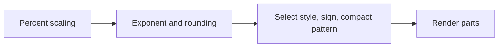

# Compact NumberFormat patterns

Proposed in [tc39/ecma402#1117](https://github.com/tc39/ecma402/pull/1117), targeting
[#439](https://github.com/tc39/ecma402/issues/439). No new JavaScript API.

Current composition puts compact notation inside a fixed style/sign pattern.
That cannot express layouts where compact text or percent moves outside the sign.
The proposal selects one complete compact pattern instead:

- Add `[[compactPatterns]]`, indexed by compact display, style/display options,
  sign, and exponent. Exponent zero covers small values, NaN, and infinities.
- Pass the exponent to `GetNumberFormatPattern`. Render compact placeholders
  alongside style/sign placeholders; keep scientific/engineering subpatterns.
- Allow notation-dependent percent text. Keep scaling once and `percentSign`
  parts. Native compact-percent `unit` parts remain a compatibility question.
- Preserve existing numberless templates for nonzero exponents. Conditional
  exact-count selection, such as French `mille` / `2 mille`, needs a separate change.

Strict spec lint/build passes. A local harness interprets the changed lookup
algorithms across 322,560 synthetic combinations; engine/Test262 coverage remains
follow-up work. The PR is proposed, not accepted.

[Polyfill PR #7940](https://github.com/formatjs/formatjs/pull/7940) follows the
current spec. [Source analysis and measurements](2026-11-14-compact-percent-icu-spec.md).
