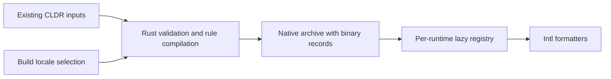

# Rust Intl extensions on Hermes

The C++ adapter requires C++17 and exceptions enabled. Compile against the
embedding runtime's JSI headers with matching ABI and toolchain settings.

`canonical_locales` installs `Intl.getCanonicalLocales` through public JSI.
The JS wrapper preserves locale-list coercion and property access order; Rust
validates and canonicalizes each tag using ICU4X and CLDR aliases. No WASM runtime
or asynchronous bridge is involved.

Install before application code:

```cpp
#include <formatjs/hermes/canonical_locales.h>

formatjs::installCanonicalLocales(*runtime);
```

Inside FormatJS, link `//native/hermes:canonical_locales`. External consumers
use the [standalone SDK](package/README.md) and link
`@formatjs_intl_getcanonicallocales_hermes//:canonical_locales` with their Hermes
runtime. The desktop SDK ships Rust static libraries for Linux x86_64 GNU and
macOS arm64; the Android SDK ships arm64 and x86_64 archives. Consumers compile
its C++ adapter against their matching JSI headers.

Canonicalization returns Rust-owned UTF-8 buffers; the adapter releases each
buffer after copying it into a JSI string. The JS factory retains at most 64
validated tag strings, with input/output lengths at most 128 UTF-16 units.
Coercion and list traversal still run every call; public result arrays remain
fresh. Locale instances use owned Rust handles managed by JSI garbage collection.

## Locale, supported values and plural rules

The SDK also includes `Intl.Locale`, `Intl.supportedValuesOf` and
`Intl.PluralRules`. Reinstall canonicalization after Locale so its intrinsic
brand check recognizes the newly installed constructor:

```cpp
#include <formatjs/hermes/intl_locale.h>
#include <formatjs/hermes/intl_pluralrules.h>
#include <formatjs/hermes/supported_values.h>

formatjs::installCanonicalLocales(*runtime);
formatjs::installSupportedValuesOf(*runtime);
formatjs::installLocale(*runtime);
formatjs::installCanonicalLocales(*runtime);
formatjs::installPluralRules(*runtime);
```

Each installer also accepts the precompiled `extensions` object shown below.
Link SDK targets `:locale`, `:supported_values` and `:pluralrules` alongside
`:canonical_locales`.
Locale's private WeakMap retains its native handle; JS subclasses and prototype
changes cannot forge that brand. Information methods query current formatter
support, so locale data loaded after construction remains visible. Bounded caches
share immutable native Locale models and scalar snapshots; constructor and
transform results remain distinct JS objects. Option getters run on every call.

Native formatter registries prepare best-fit matching lazily. Registering new
locale IDs refreshes their matcher; replacing existing locale data keeps the
same matching index. Existing formatter instances retain their data.

## Standalone installation

Build and extract the SDK on Linux:

```sh
bazel build -c opt //native/hermes/package:sdk
sdk_archive="$(bazel cquery -c opt --output=files //native/hermes/package:sdk)"
sdk_dir="$(mktemp -d)"
tar -xzf "$sdk_archive" -C "$sdk_dir"
cd examples/hermes-intl
bazel test --config=linux \
  --override_module=formatjs_intl_getcanonicallocales_hermes="$sdk_dir" \
  //:smoke_test
```

The [independent example](../../examples/hermes-intl/README.md) consumes only the
extracted SDK's public layout. It compiles `js/extensions.js` using the execution
platform's `hermesc`, evaluates the resulting bytecode into a setup object, then
installs it before application code:

```cpp
auto extensions = runtime->evaluateJavaScript(bytecode, "extensions.hbc")
                      .asObject(*runtime);
formatjs::installCanonicalLocales(*runtime, extensions);
```

## Hermes extension registration

The SDK includes a [Hermes contrib package](package/contrib/README.md) with all
12 JavaScript fragments, one C++ installer, and CMake linkage. Add those sources
to Hermes' contrib extension dispatcher to install Intl before application code.
The complete `js/extensions.js` bundle remains for standalone startup.

## Compiled locale data

The SDK embeds locale records in its Rust archive, like `formatjs_intl`'s
compiled-data configuration. Installing a formatter makes those locales available;
application JS and C++ do not register locale JSON.

Default locales follow [Chromium desktop's full-data UI language filter](https://chromium.googlesource.com/chromium/deps/icu/+/2a51536dfb3b448bdf3dae70c782ea2879c90904/filters/common.json),
including regional and script variants available in this checkout. This selects locale
coverage; it does not copy Chrome's per-resource trimming or promise identical ICU results.
Use `--//crates/intl_data:locales=\*` for every CLDR locale. Select a custom set:

```sh
bazel build -c opt --//crates/intl_data:locales=en,fr //native/hermes/package:sdk
```

The setting applies to both platform archives. Locale selection uses Rust matching for scripts, regions and default-content
aliases. Formatters without matching data retain their native fallback. Unknown
languages fail the build. Rebuild the Rust archive to add another locale.

Rust build tools validate the original CLDR packs, compile plural-rule expressions,
and emit binary records. Calendar locale patches join their base DateTimeFormat
record at build time. Runtime registries decode records lazily and cache them
independently, so unit updates and explicit overrides cannot leak between runtimes.
The raw CLDR extraction remains shared with the TS packages.



Source builds can select the same provider with
`--//crates/intl_data:compiled=true`. Rust callers use each formatter's
`:with_compiled_data` target and `Registry::with_compiled_data()`;
DateTimeFormat exposes `Runtime::with_compiled_data()`. The uncompiled targets
retain explicit registration for custom providers and original TS conformance
fixtures. Their JSON hooks remain available for intentional runtime overrides.

Calendar arithmetic/table providers and timezone transitions remain independently
selectable. Compiling a locale includes its calendar names and patterns; enabling
an optional calendar provider no longer requires a separate locale patch.

## Development runner

The standalone host runner uses the native Bazel module from
[formatjs/hermes](https://github.com/formatjs/hermes), with Intl disabled. It
installs the Rust implementation, then evaluates each script in the same runtime.
`print()` and monotonic `performance.now()` are available. `--prelude=path.js`
evaluates a startup script between initial installation and final installation.
This permits loading a trusted `Intl.Locale` polyfill, whose intrinsic brand
method is captured during final installation. Install any Locale implementation
before the final adapter installation; ordinary arguments run afterward.

```sh
bazel test -c opt //native/hermes:canonical_locales_test
bazel run -c opt //native/hermes:hermes_runner -- /absolute/path/script.js
```

The host runner is an explicit development target. CI cross-builds the SDK and
standalone macOS executable on Linux; macOS only runs the downloaded artifacts.

`--extensions=/absolute/path/bundle` evaluates a source or bytecode factory
bundle and installs its available native extensions before ordinary scripts. `//native/hermes:pluralrules_bridge_test` exercises loaded packs,
matching, owned instances, ranges and late replacement through JSI.
`//native/hermes/tests:pluralrules_conformance_test` compares the installed public
API with TS through source and optimized-bytecode installers, plus coercion order,
brands, subclasses, descriptors and captured intrinsics. Link
`//native/hermes:pluralrules` and call `installPluralRules(runtime)` after
canonicalization. SDK locale data is compiled into Rust as described above.
The independent SDK consumer verifies compiled English/French data, retained instances, BigInt, ranges and receiver checks on Linux and macOS.

## ListFormat

Link `//native/hermes:listformat` (SDK `:listformat`) and call
`installListFormat(runtime)` after canonicalization. The overload accepting
`extensions` uses the precompiled `IntlListFormat` factory. SDK locale data is compiled into Rust.

Rust owns patterns, matching and parts. The TS facade supplies receiver brands,
option access and StringListFromIterable, including IteratorClose. UTF-16 unit
arrays preserve lone surrogates across the ABI. The native conformance target
Omitted constructor options use one Rust call for negotiation and default
construction. Explicit options keep their observable getter order.

`//native/hermes/tests:listformat_conformance_test` compares the public API with
TS through source and optimized-bytecode installers. `--native-listformat`
enables the source installer in the development runner.

## DisplayNames

Link `//native/hermes:displaynames` (SDK `:displaynames`) and call
`installDisplayNames(runtime)` after canonicalization. The overload accepting
`extensions` uses the precompiled `IntlDisplayNames` factory. SDK locale data is compiled into Rust.

Rust owns code validation, canonicalization, CLDR lookup and locale matching.
The TS facade handles required options, getter/coercion order and receiver brands.
UTF-16 code arrays let Rust report lone surrogates as RangeError. Native
conformance compares source/optimized-bytecode installation with TS across all
six name types, styles and fallbacks. `--native-displaynames` enables the source
installer in the development runner.

## Segmenter

Link `//native/hermes:segmenter`; call `formatjs::installSegmenter(runtime)` after
canonical locales. The overload taking the extension object invokes the compiled
`IntlSegmenter` factory. `--native-segmenter` enables the source factory in the
runner; its conformance test also runs the optimized bytecode factory.

Rust owns UTF-16 boundary tables and independent cursors. JS handles observable
coercions, private brands, ordinary records and iterator prototypes. Grapheme data
and dictionary/LSTM models are static, matching the existing package's loading
model. Word/sentence boundaries can differ from TS; the crate conformance test
asserts both profiles explicitly. SDK target `:segmenter` ships the same adapter and fragment, plus a typed consumer
smoke example.

## Collator

Link `//native/hermes:collator` (SDK `:collator`); call
`formatjs::installCollator(runtime)` after canonicalization. The overload taking
an extension object invokes the precompiled `IntlCollator` factory. The SDK
includes `37-IntlCollator.js`, public headers, adapter source and a typed smoke
example. Data stays static, matching TS.

Rust owns CLDR root/prefix/tailoring data, locale extension resolution, search and
comparison. ICU4X supplies normalization/casing. JS preserves constructor/prototype
access, option order, private brands, ToString order and cached non-constructor
bound functions. Source/bytecode tests compare 6,720 cases per mode with TS.

## RelativeTimeFormat

Link `//native/hermes:relativetimeformat` and install canonicalization before
`formatjs::installRelativeTimeFormat(runtime)`. Compiled records own relative,
number and plural data; no JS NumberFormat/PluralRules or host ICU is needed.

All units, styles, numeric modes, numbering systems and parts use Rust records.
The facade preserves brands, ToNumber/ToString order, negative zero and UTF-16
unit rejection. Locale/numbering-system resolution precedes style/numeric getters;
relative fields are fetched afterward. Existing instances retain loaded data.
The precompiled overload uses `IntlRelativeTimeFormat` from
`39-IntlRelativeTimeFormat.js`. SDK setup and a typed smoke example are documented
in [package/README.md](package/README.md).

## DateTimeFormat

Link `//native/hermes:datetimeformat`, install canonicalization, then retain the
installation guard on the JavaScript thread:

```cpp
formatjs::installCanonicalLocales(*runtime);
auto dateTime = formatjs::installDateTimeFormat(*runtime);
```

Destroy `dateTime` before `runtime`. The overload taking an extension object uses
its `IntlDateTimeFormat` factory. GC finalizers only queue IDs; native calls and
guard teardown release Rust handles on their creating thread. Host functions hold
weak installation references, so retained JS formatters fail after guard release.

SDK base locales and calendar locale patches are compiled into Rust. Calendar
arithmetic/table providers and timezone packs remain independent through
`__addCalendarData` and `__addTZData`. Custom calendar records accept `{calendar, dateFromTime}` functions;
they receive adjusted local milliseconds with the public calendar registry as
`this`. Callbacks may reenter formatting, replace providers or throw JS values.
The bridge preserves exception identity without unwinding through Rust.

The facade preserves constructor getter phases, callable construction, bound
format identity, receiver brands, coercion and intrinsic Temporal reads. Actual
Temporal objects must be available before installation. Plain values serialize
through captured intrinsics; Rust computes their reference dates and nanoseconds.
The SDK embeds locale data and exports optional calendar/timezone resources, both native
headers and adapter sources. See [package/README.md](package/README.md#datetimeformat)
for installation and guard lifetime requirements.

## DurationFormat

Link `//native/hermes:durationformat`, install canonicalization, then call
`formatjs::installDurationFormat(runtime)`. The overload taking an extension object
uses its `IntlDurationFormat` factory. This context contains native Rust data and
needs no installation guard.

Duration locale metadata stays static. Its private NumberFormat and ListFormat
registries use the build-selected compiled provider. Rendering calls no public JS
formatters. Explicit custom-provider registration and unit overrides remain available.

JS preserves constructor/record getter order, primitive coercion and private brands.
Rust resolves locale before style getters, validates each style before its display,
then folds subseconds and composes parts exactly. Install Temporal before the
facade to accept duration strings and branded durations through captured intrinsics.
Without Temporal, duration-like records work and strings throw RangeError.
Source/bytecode differential coverage includes ten locales, non-colon separators,
Temporal brands, negative leading zero and IEEE integers beyond the safe range.
Default-runtime smoke also runs both modes without Temporal. The SDK packages both installers and typed smoke; see
[SDK installation](package/README.md#durationformat) for dependency paths.

## Native bridge

Rust owns Intl records, locale data, and formatting. C++ adapts JSI values,
callbacks, and foreign exceptions. Adapters share `bridge.h` for transport,
branded handles, owned buffers, and factory installation.

C ABI headers generate from Rust exports through `//tools/ffi_headers`, using
pinned cbindgen source and its upstream Cargo lock. Type renames preserve public
C names. The SDK ships generated headers and the shared bridge; SDK consumers
need neither Rust nor cbindgen to build the JSI adapters.

DateTimeFormat also keeps its handle table and deferred releases in Rust. GC
threads drop release tickets; the runtime thread drains formatter records. Only
JSI references and foreign exception identity remain in the C++ adapter.

## Existing package conformance

Each `//native/hermes/tests:<polyfill>_package_conformance_test` reuses package API
test bodies against Rust JSI, in source and optimized-bytecode installer modes.
Each file gets a fresh Hermes runtime. Supporting formatters remain real TS
implementations; native data envelopes preserve the original test payloads.

Current targets: `supportedvaluesof`, `locale`, `pluralrules`, `listformat`, `displaynames`, `segmenter`, `collator`, `numberformat`, `relativetimeformat`, `datetimeformat`, `durationformat`, `getcanonicallocales`.

Segmenter uses the original Unicode files, parser, and package case filters.

NumberFormat reuses all 88 checked-in snapshot files. Snapshot values are decoded
at build time, never rewritten. Missing, changed, or unused snapshots fail.

Canonicalization uses real native Locale objects, including internal-slot checks.
Locale ICU-specific collation expectations have separate cases, retaining the
other locale-info assertions and original expected values.

Explicit exclusion reports identify TS-private state, implementation-defined
diagnostics, and host-specific behavior. Original TS unit suites retain those
checks. Unsupported assertions, stale exclusions, and unmet assertion counts fail.
The host timezone stays UTC.

DurationFormat owns its Rust formatter registry; host NumberFormat replacement
tests remain TS-only.
