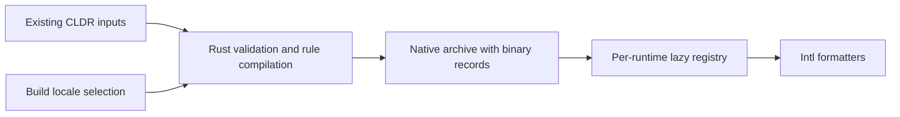

# FormatJS Intl Hermes SDK

Version `0.1.0` packages the Rust C ABI, C++ JSI adapter, and Hermes extension
JavaScript. This archive is built from the repository; it is not published to
BCR, npm, or crates.io.

The archive contains:

```text
MODULE.bazel
BUILD.bazel
include/formatjs/hermes/canonical_locales.h
include/formatjs/intl/canonicalize.h
include/formatjs/hermes/supported_values.h
include/formatjs/intl/supported_values.h
include/formatjs/hermes/intl_locale.h
include/formatjs/intl/locale.h
include/formatjs/hermes/intl_pluralrules.h
include/formatjs/hermes/intl_listformat.h
include/formatjs/intl/listformat.h
include/formatjs/intl/pluralrules.h
src/canonical_locales.cpp
src/get_canonical_locales.inc
src/supported_values.cpp
src/supported_values_of.inc
src/locale.cpp
src/locale.inc
src/pluralrules.cpp
src/pluralrules.inc
src/listformat.cpp
src/listformat.inc
js/30-IntlGetCanonicalLocales.js
js/31-IntlSupportedValuesOf.js
js/32-IntlLocale.js
js/33-IntlPluralRules.js
js/34-IntlListFormat.js
js/listformat-smoke.js
examples/listformat-smoke.ts
js/extensions.js
js/pluralrules-smoke.js
examples/pluralrules-smoke.ts
lib/x86_64-unknown-linux-gnu/libformatjs_intl_hermes.a
lib/aarch64-apple-darwin/libformatjs_intl_hermes.a
```

Rust and its compiled ICU data are prebuilt for Linux x86_64 GNU and macOS
arm64. The consumer compiles the thin C++ adapter against its Hermes JSI
headers. Android, iOS, and other target triples are not included.

## Build and install

From a FormatJS checkout on Linux:

```sh
bazel build -c opt //native/hermes/package:sdk
sdk_archive="$(bazel cquery -c opt --output=files //native/hermes/package:sdk)"
sdk_dir="$(mktemp -d)"
tar -xzf "$sdk_archive" -C "$sdk_dir"
```

Add the SDK module to the consumer's `MODULE.bazel`:

```starlark
bazel_dep(name = "formatjs_intl_getcanonicallocales_hermes", version = "0.1.0")
```

Until publication, pass the extracted directory to every consumer invocation:

```sh
bazel build --override_module=formatjs_intl_getcanonicallocales_hermes="$sdk_dir" //:app
```

Link `@formatjs_intl_getcanonicallocales_hermes//:canonical_locales` and your
Hermes runtime. The root module must supply the Hermes archive override and its
own C++ toolchain; the SDK registers no toolchains and requires no Rust compiler.
See `examples/hermes-intl` in FormatJS for a complete independent root.

The SDK also contains `Intl.supportedValuesOf`. Link
`@formatjs_intl_getcanonicallocales_hermes//:supported_values` for that adapter.
Link `@formatjs_intl_getcanonicallocales_hermes//:locale` for `Intl.Locale`.
Link `@formatjs_intl_getcanonicallocales_hermes//:pluralrules` for `Intl.PluralRules`.
Link `@formatjs_intl_getcanonicallocales_hermes//:listformat` for `Intl.ListFormat`.
All five targets use one Rust archive. The module retains its original name.

## Install before application JavaScript

For embedders that allow source evaluation:

```cpp
#include <formatjs/hermes/canonical_locales.h>
#include <formatjs/hermes/supported_values.h>
#include <formatjs/hermes/intl_locale.h>
#include <formatjs/hermes/intl_pluralrules.h>
#include <formatjs/hermes/intl_listformat.h>

formatjs::installCanonicalLocales(*runtime);
formatjs::installSupportedValuesOf(*runtime);
formatjs::installLocale(*runtime);
formatjs::installCanonicalLocales(*runtime); // Capture the new Locale brand.
formatjs::installPluralRules(*runtime);
formatjs::installListFormat(*runtime);
```

For bytecode-only startup, compile `js/extensions.js` with the same `hermesc`
version as the runtime. Evaluate that bytecode to obtain its setup object, then
pass the object to the installer:

```cpp
auto extensions = runtime->evaluateJavaScript(bytecode, "extensions.hbc")
                      .asObject(*runtime);
formatjs::installCanonicalLocales(*runtime, extensions);
formatjs::installSupportedValuesOf(*runtime, extensions);
formatjs::installLocale(*runtime, extensions);
formatjs::installCanonicalLocales(*runtime, extensions);
formatjs::installPluralRules(*runtime, extensions);
formatjs::installListFormat(*runtime, extensions);
```

## Compiled locale data

The SDK embeds locale records in its Rust archive, like `formatjs_intl`'s
compiled-data configuration. Installing a formatter makes those locales available;
application JS and C++ do not register locale JSON.

Default locales follow [Chromium desktop's full-data UI language filter](https://chromium.googlesource.com/chromium/deps/icu/+/2a51536dfb3b448bdf3dae70c782ea2879c90904/filters/common.json),
including regional and script variants available in this checkout. This selects locale
coverage; it does not copy Chrome's per-resource trimming or promise identical ICU results.
Use `--//crates/intl_data:locales=\*` for every CLDR locale. Select a custom set:

```sh
bazel build -c opt --//crates/intl_data:locales=en,fr //native/hermes/package:sdk
```

The setting applies to both platform archives. Locale selection uses Rust matching for scripts, regions and default-content
aliases. Formatters without matching data retain their native fallback. Unknown
languages fail the build. Rebuild the Rust archive to add another locale.

Rust build tools validate the original CLDR packs, compile plural-rule expressions,
and emit binary records. Runtime registries decode records lazily and cache them
independently, so unit updates and explicit overrides cannot leak between runtimes.
The raw CLDR extraction remains shared with the TS packages.



Source builds can select the same provider with
`--//crates/intl_data:compiled=true`. Rust callers use each formatter's
`:with_compiled_data` target and `Registry::with_compiled_data()`;
The uncompiled targets
retain explicit registration for custom providers and original TS conformance
fixtures. Their JSON hooks remain available for intentional runtime overrides.

The standalone example builds this bytecode through Bazel's execution toolchain,
so cross-compilation never runs the target-platform `hermesc`.

Install a trusted `Intl.Locale` implementation before the final installer call.
If the Locale polyfill itself needs `Intl.getCanonicalLocales`, install this
adapter first, load Locale, then reinstall the adapter before application code.
The final installation captures Locale's intrinsic brand method. The SDK's
Locale installer works without NumberFormat or Collator. It uses current
formatter capabilities on each information-method call; adding locale data
after constructing a Locale updates those results without recreating it.
The private HostObject releases its Rust record when the JS instance is collected.

Install `supportedValuesOf` after trusted `Intl.DateTimeFormat`,
`Intl.NumberFormat` and `Intl.Collator` implementations. Rust enumerates shared
CLDR/IANA candidates; JSI probes those formatters to determine runtime support.
Missing formatters produce empty categories, as in the TypeScript polyfill.
This installer does not install the formatters themselves. Results are fresh
arrays; no support cache is shared between runtimes or calls.

## Hermes core/contrib extension integration

Hermes extensions use explicit build-time registration. Copy
`js/30-IntlGetCanonicalLocales.js` into the enabled extension source list before
Hermes embeds its extension bytecode. Compile the SDK adapter, link the static
library for the target triple, then call
`formatjs::installCanonicalLocales(runtime, extensions)` from the C++ extension
dispatcher after any trusted Locale installer. Use the same SDK version for the
JavaScript fragment and C++ adapter.

The standalone `js/extensions.js` already wraps the fragment in a setup-object
factory. Do not add that complete bundle to Hermes' concatenated extension
source list. Linking this SDK alone does not register a Hermes startup hook.

For `Locale`, register `js/32-IntlLocale.js`, link `:locale`, and call
`formatjs::installLocale(runtime, extensions)` before the final canonicalization
installer. The same order applies to source and precompiled setup paths.

For `supportedValuesOf`, register `js/31-IntlSupportedValuesOf.js` and call
`formatjs::installSupportedValuesOf(runtime, extensions)` after formatter setup.

Non-Bazel embedders can use the same headers, adapter source, and archive. Add
`include/` to the include path and keep the private `.inc` beside the adapter.
Compile as C++17 with exceptions enabled and match the embedding runtime's JSI
ABI and toolchain settings.
The SDK's `BUILD.bazel` records the supported platform selection and native
system linker flags.

ListFormat uses the compiled Rust provider. Its smoke checks parts, UTF-16,
IteratorClose and localized formatting without locale JSON injection.
