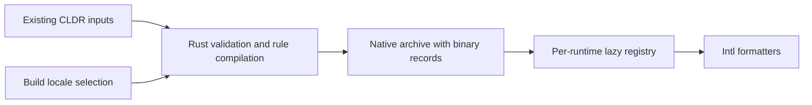

# FormatJS Intl Hermes SDK

Version `0.1.0` packages the Rust C ABI, C++ JSI adapter, and Hermes extension
JavaScript. This archive is built from the repository; it is not published to
BCR, npm, or crates.io.

The archive contains:

```text
MODULE.bazel
BUILD.bazel
include/formatjs/hermes/canonical_locales.h
include/formatjs/intl/canonicalize.h
include/formatjs/hermes/supported_values.h
include/formatjs/intl/supported_values.h
include/formatjs/hermes/intl_locale.h
include/formatjs/intl/locale.h
include/formatjs/hermes/intl_pluralrules.h
include/formatjs/hermes/intl_listformat.h
include/formatjs/hermes/intl_displaynames.h
include/formatjs/intl/displaynames.h
include/formatjs/hermes/intl_segmenter.h
include/formatjs/intl/segmenter.h
include/formatjs/hermes/intl_collator.h
include/formatjs/hermes/intl_datetimeformat.h
include/formatjs/hermes/intl_durationformat.h
include/formatjs/intl/durationformat.h
include/formatjs/intl/datetimeformat.h
include/formatjs/intl/datetimeformat_calendars.h
include/formatjs/hermes/intl_numberformat.h
include/formatjs/intl/numberformat.h
include/formatjs/intl/collator.h
include/formatjs/intl/listformat.h
include/formatjs/intl/pluralrules.h
src/canonical_locales.cpp
src/get_canonical_locales.inc
src/supported_values.cpp
src/supported_values_of.inc
src/locale.cpp
src/locale.inc
src/pluralrules.cpp
src/pluralrules.inc
src/listformat.cpp
src/listformat.inc
src/displaynames.cpp
src/displaynames.inc
src/segmenter.cpp
src/segmenter.inc
src/collator.cpp
src/collator.inc
src/datetimeformat.cpp
src/datetimeformat.inc
src/durationformat.cpp
src/durationformat.inc
js/41-IntlDurationFormat.js
js/durationformat-smoke.js
examples/durationformat-smoke.ts
js/40-IntlDateTimeFormat.js
js/datetimeformat-smoke.js
examples/datetimeformat-smoke.ts
calendar-data/datetimeformat/<calendar>.json
timezone-data/datetimeformat/tz-{all,golden}.json
src/numberformat.cpp
src/numberformat.inc
js/30-IntlGetCanonicalLocales.js
js/31-IntlSupportedValuesOf.js
js/32-IntlLocale.js
js/33-IntlPluralRules.js
js/34-IntlListFormat.js
js/35-IntlDisplayNames.js
js/36-IntlSegmenter.js
js/37-IntlCollator.js
js/38-IntlNumberFormat.js
js/numberformat-smoke.js
examples/numberformat-smoke.ts
js/collator-smoke.js
examples/collator-smoke.ts
js/segmenter-smoke.js
examples/segmenter-smoke.ts
js/displaynames-smoke.js
examples/displaynames-smoke.ts
js/listformat-smoke.js
examples/listformat-smoke.ts
js/extensions.js
js/pluralrules-smoke.js
examples/pluralrules-smoke.ts
lib/x86_64-unknown-linux-gnu/libformatjs_intl_hermes.a
lib/aarch64-apple-darwin/libformatjs_intl_hermes.a
```

Rust and its compiled ICU data are prebuilt for Linux x86_64 GNU and macOS
arm64. The consumer compiles the thin C++ adapter against its Hermes JSI
headers. Android, iOS, and other target triples are not included.

## Build and install

From a FormatJS checkout on Linux:

```sh
bazel build -c opt //native/hermes/package:sdk
sdk_archive="$(bazel cquery -c opt --output=files //native/hermes/package:sdk)"
sdk_dir="$PWD/examples/hermes-intl/.cache/sdk"
mkdir -p "$sdk_dir"
tar -xzf "$sdk_archive" -C "$sdk_dir"
```

Add the SDK module to the consumer's `MODULE.bazel`:

```starlark
bazel_dep(name = "formatjs_intl_getcanonicallocales_hermes", version = "0.1.0")
```

Until publication, pass the extracted directory to every consumer invocation:

```sh
bazel build --override_module=formatjs_intl_getcanonicallocales_hermes="$sdk_dir" //:app
```

Link `@formatjs_intl_getcanonicallocales_hermes//:canonical_locales` and your
Hermes runtime. The root module must supply the Hermes archive override and its
own C++ toolchain; the SDK registers no toolchains and requires no Rust compiler.
See `examples/hermes-intl` in FormatJS for a complete independent root.

The SDK also contains `Intl.supportedValuesOf`. Link
`@formatjs_intl_getcanonicallocales_hermes//:supported_values` for that adapter.
Link `@formatjs_intl_getcanonicallocales_hermes//:locale` for `Intl.Locale`.
Link `@formatjs_intl_getcanonicallocales_hermes//:pluralrules` for `Intl.PluralRules`.
Link `@formatjs_intl_getcanonicallocales_hermes//:listformat` for `Intl.ListFormat`.
Link `@formatjs_intl_getcanonicallocales_hermes//:displaynames` for `Intl.DisplayNames`.
Link `@formatjs_intl_getcanonicallocales_hermes//:segmenter` for `Intl.Segmenter`.
Link `@formatjs_intl_getcanonicallocales_hermes//:collator` for `Intl.Collator`.
Link `@formatjs_intl_getcanonicallocales_hermes//:numberformat` for `Intl.NumberFormat`.
All nine targets use one Rust archive. The module retains its original name.

## Install before application JavaScript

For embedders that allow source evaluation:

```cpp
#include <formatjs/hermes/canonical_locales.h>
#include <formatjs/hermes/supported_values.h>
#include <formatjs/hermes/intl_locale.h>
#include <formatjs/hermes/intl_pluralrules.h>
#include <formatjs/hermes/intl_listformat.h>
#include <formatjs/hermes/intl_displaynames.h>
#include <formatjs/hermes/intl_segmenter.h>
#include <formatjs/hermes/intl_collator.h>
#include <formatjs/hermes/intl_numberformat.h>

formatjs::installCanonicalLocales(*runtime);
formatjs::installSupportedValuesOf(*runtime);
formatjs::installLocale(*runtime);
formatjs::installCanonicalLocales(*runtime); // Capture the new Locale brand.
formatjs::installPluralRules(*runtime);
formatjs::installListFormat(*runtime);
formatjs::installDisplayNames(*runtime);
formatjs::installSegmenter(*runtime);
formatjs::installCollator(*runtime);
formatjs::installNumberFormat(*runtime);
```

For bytecode-only startup, compile `js/extensions.js` with the same `hermesc`
version as the runtime. Evaluate that bytecode to obtain its setup object, then
pass the object to the installer:

```cpp
auto extensions = runtime->evaluateJavaScript(bytecode, "extensions.hbc")
                      .asObject(*runtime);
formatjs::installCanonicalLocales(*runtime, extensions);
formatjs::installSupportedValuesOf(*runtime, extensions);
formatjs::installLocale(*runtime, extensions);
formatjs::installCanonicalLocales(*runtime, extensions);
formatjs::installPluralRules(*runtime, extensions);
formatjs::installListFormat(*runtime, extensions);
formatjs::installDisplayNames(*runtime, extensions);
formatjs::installSegmenter(*runtime, extensions);
formatjs::installCollator(*runtime, extensions);
formatjs::installNumberFormat(*runtime, extensions);
```

## Compiled locale data

The SDK embeds locale records in its Rust archive, like `formatjs_intl`'s
compiled-data configuration. Installing a formatter makes those locales available;
application JS and C++ do not register locale JSON.

Default locales follow [Chromium desktop's full-data UI language filter](https://chromium.googlesource.com/chromium/deps/icu/+/2a51536dfb3b448bdf3dae70c782ea2879c90904/filters/common.json),
including regional and script variants available in this checkout. This selects locale
coverage; it does not copy Chrome's per-resource trimming or promise identical ICU results.
Use `--//crates/intl_data:locales=\*` for every CLDR locale. Select a custom set:

```sh
bazel build -c opt --//crates/intl_data:locales=en,fr //native/hermes/package:sdk
```

The setting applies to both platform archives. Locale selection uses Rust matching for scripts, regions and default-content
aliases. Formatters without matching data retain their native fallback. Unknown
languages fail the build. Rebuild the Rust archive to add another locale.

Rust build tools validate the original CLDR packs, compile plural-rule expressions,
and emit binary records. Calendar locale patches join their base DateTimeFormat
record at build time. Runtime registries decode records lazily and cache them
independently, so unit updates and explicit overrides cannot leak between runtimes.
The raw CLDR extraction remains shared with the TS packages.



Source builds can select the same provider with
`--//crates/intl_data:compiled=true`. Rust callers use each formatter's
`:with_compiled_data` target and `Registry::with_compiled_data()`;
DateTimeFormat exposes `Runtime::with_compiled_data()`. The uncompiled targets
retain explicit registration for custom providers and original TS conformance
fixtures. Their JSON hooks remain available for intentional runtime overrides.

Calendar arithmetic/table providers and timezone transitions remain independently
selectable. Compiling a locale includes its calendar names and patterns; enabling
an optional calendar provider no longer requires a separate locale patch.

The standalone example builds this bytecode through Bazel's execution toolchain,
so cross-compilation never runs the target-platform `hermesc`.

Install a trusted `Intl.Locale` implementation before the final installer call.
If the Locale polyfill itself needs `Intl.getCanonicalLocales`, install this
adapter first, load Locale, then reinstall the adapter before application code.
The final installation captures Locale's intrinsic brand method. The SDK's
Locale installer works without NumberFormat or Collator. It uses current
formatter capabilities on each information-method call; adding locale data
after constructing a Locale updates those results without recreating it.
The private HostObject releases its Rust record when the JS instance is collected.

Install `supportedValuesOf` after trusted `Intl.DateTimeFormat`,
`Intl.NumberFormat` and `Intl.Collator` implementations. Rust enumerates shared
CLDR/IANA candidates; JSI probes those formatters to determine runtime support.
Missing formatters produce empty categories, as in the TypeScript polyfill.
This installer does not install the formatters themselves. Results are fresh
arrays; no support cache is shared between runtimes or calls.

## Hermes core/contrib extension integration

Hermes extensions use explicit build-time registration. Copy
`js/30-IntlGetCanonicalLocales.js` into the enabled extension source list before
Hermes embeds its extension bytecode. Compile the SDK adapter, link the static
library for the target triple, then call
`formatjs::installCanonicalLocales(runtime, extensions)` from the C++ extension
dispatcher after any trusted Locale installer. Use the same SDK version for the
JavaScript fragment and C++ adapter.

The standalone `js/extensions.js` already wraps the fragment in a setup-object
factory. Do not add that complete bundle to Hermes' concatenated extension
source list. Linking this SDK alone does not register a Hermes startup hook.

For `Locale`, register `js/32-IntlLocale.js`, link `:locale`, and call
`formatjs::installLocale(runtime, extensions)` before the final canonicalization
installer. The same order applies to source and precompiled setup paths.

For `supportedValuesOf`, register `js/31-IntlSupportedValuesOf.js` and call
`formatjs::installSupportedValuesOf(runtime, extensions)` after formatter setup.

Non-Bazel embedders can use the same headers, adapter source, and archive. Add
`include/` to the include path and keep the private `.inc` beside the adapter.
Compile as C++17 with exceptions enabled and match the embedding runtime's JSI
ABI and toolchain settings.
The SDK's `BUILD.bazel` records the supported platform selection and native
system linker flags.

ListFormat uses the compiled Rust provider. Its smoke checks parts, UTF-16,
IteratorClose and localized formatting without locale JSON injection.

DisplayNames uses compiled names, including sparse CLDR fallbacks. The smoke
checks English, French and Afar without locale JSON injection.

Segmenter uses compiled ICU4X data, including dictionary/LSTM word models. Link
`:segmenter`, install after canonicalization, or register `js/36-IntlSegmenter.js`
and invoke `installSegmenter(runtime, extensions)`. No locale pack loading is
needed. Segments retain original UTF-16 input; iterators advance independently.
Word/sentence profiles can differ from TS; both profiles have conformance tests.
The independent consumer runs `examples/segmenter-smoke.ts` from this SDK.

Collator uses compiled CLDR sort/search data with ICU4X normalization and casing.
Link `:collator`; install after canonicalization, or register
`js/37-IntlCollator.js` and call `installCollator(runtime, extensions)`. No locale
pack loading is needed. The cached bound comparison function retains its original
instance and accepts exact UTF-16 input. `examples/collator-smoke.ts` covers search,
locale tailorings, numeric runs, canonical equivalence, brands and descriptors.

Collator requires the Hermes proxy-construction fix in overlay commit
`338ff13ff1e996934ae615952d174f8c621844d9`, included in the pending BCR
version `260318099.0.0-393a539e6`.
Use the pinned override from `examples/hermes-intl/MODULE.bazel`; older overlays
perform extra observable `newTarget.prototype` reads during construction.

NumberFormat uses compiled number and plural records. Link `:numberformat` and
install after canonicalization; no JS PluralRules installer or host ICU is needed.

For precompiled setup, register `js/38-IntlNumberFormat.js` and invoke
`installNumberFormat(runtime, extensions)`. Construction uses the same pinned
Hermes proxy fix as Collator. NumberFormat supports decimal, percent, currency,
units, compact/scientific/engineering notation, parts and ranges. Its cached bound
format function retains its original instance. Locale replacement affects future
instances; `__addUnitData(locale, unitJsonText)` explicitly updates shared units.
`examples/numberformat-smoke.ts` checks exact strings/BigInts, localized exponents,
ranges, brands, and compiled English/French data from the extracted SDK.

## RelativeTimeFormat

Link `@formatjs_intl_getcanonicallocales_hermes//:relativetimeformat` and include
`<formatjs/hermes/intl_relativetimeformat.h>`. After canonicalization, call
`formatjs::installRelativeTimeFormat(runtime)`. For precompiled installation,
register `js/39-IntlRelativeTimeFormat.js` and call
`formatjs::installRelativeTimeFormat(runtime, extensions)`.

Relative, number and plural records come from the compiled Rust provider. Installing
JS NumberFormat or PluralRules is unnecessary. Every unit, style, numeric mode,
numbering system and formatted part uses the Rust implementation.

`examples/relativetimeformat-smoke.ts` ships compiled as
`js/relativetimeformat-smoke.js`. The independent consumer uses compiled English/French data,
checks negative zero, named forms, parts, Arabic digits, BigInt rejection and
operation with global NumberFormat/PluralRules removed. Rust ABI callers use
`include/formatjs/intl/relativetimeformat.h`; adapter sources live in
`src/relativetimeformat.cpp` and `src/relativetimeformat.inc`.

## DateTimeFormat

Link `@formatjs_intl_getcanonicallocales_hermes//:datetimeformat` and include
`<formatjs/hermes/intl_datetimeformat.h>`. Retain its installation guard on the
JavaScript thread, and destroy the guard before destroying the runtime:

```cpp
formatjs::installCanonicalLocales(*runtime);
auto dateTime = formatjs::installDateTimeFormat(*runtime);
// Run application scripts while dateTime and runtime remain alive.
```

For precompiled startup, evaluate `js/extensions.js` bytecode into `extensions`
and retain `formatjs::installDateTimeFormat(*runtime, extensions)` instead.
`js/40-IntlDateTimeFormat.js` supplies the standalone `IntlDateTimeFormat` factory
for core/contrib registration. GC finalizers queue handle IDs; native calls and
guard teardown release records on their creating thread. Calling retained JS
formatters after guard release throws.

Base locale data and calendar locale patches are compiled into Rust. Optional
calendar providers still use `Intl.DateTimeFormat.__addCalendarData(text)` with
`calendar-data/datetimeformat/<calendar>.json`. Fourteen providers include selected
lunar/Umm al-Qura tables. Their locale names and patterns are already present.

Timezone transitions load through `Intl.DateTimeFormat.__addTZData(text)` from
`timezone-data/datetimeformat/tz-golden.json` or `tz-all.json`. Names are available
before loading transitions, with UTC offsets until data arrives. Replacement
updates existing instances; ranges retain one transition snapshot across endpoints.
The default timezone starts at UTC; `__setDefaultTimeZone(name)` changes subsequent
defaults. `:datetimeformat_calendar_data` and `:datetimeformat_timezone_data` expose
these resources separately.

Install Temporal before the formatter to capture its brands. ZonedDateTime is
rejected; use an Instant or plain value. JS NumberFormat/PluralRules are unnecessary.

Custom `__addCalendarData({calendar, dateFromTime})` providers receive adjusted
local milliseconds with `Intl.DateTimeFormat.calendarData` as `this`. Return typed
calendar fields; callbacks may reenter formatting and throw JS values with their
original identity preserved.

`examples/datetimeformat-smoke.ts` ships as `js/datetimeformat-smoke.js`. The
independent consumer runs source and precompiled installers with compiled locales,
parts/ranges, DST transition loading, Hebrew Adar II names and formatting after
removing JS NumberFormat/PluralRules.

## DurationFormat

Link `@formatjs_intl_getcanonicallocales_hermes//:durationformat`, include
`<formatjs/hermes/intl_durationformat.h>`, then install after canonicalization:

```cpp
formatjs::installCanonicalLocales(*runtime);
formatjs::installDurationFormat(*runtime);
```

For precompiled startup, evaluate the SDK extension bytecode and call
`formatjs::installDurationFormat(*runtime, extensions)`. The standalone factory is
`js/41-IntlDurationFormat.js`. DurationFormat needs no installation guard.

Duration locale/time-separator metadata is static. Register selected existing
number/list JSON texts as independent native dependencies:

| SDK path                                 | Registration                                      |
| ---------------------------------------- | ------------------------------------------------- |
| `locale-data/numberformat/<locale>.json` | `Intl.DurationFormat.__addNumberFormatData(text)` |
| `locale-data/listformat/<locale>.json`   | `Intl.DurationFormat.__addListFormatData(text)`   |

Use individual exported file labels to ship selected packs. Existing
`:numberformat_data` and `:listformat_data` filegroups expose all packs; Duration
adds no locale files. Its available locales stay static before dependency data
arrives. Number/list registries negotiate independently and may fall back to
loaded locales. Constructing before registration is supported; rendering needs
both dependencies. Cached option profiles retain their data after pack replacement.
Custom number unit sidecars use `__addNumberFormatUnitData` with `{locale,data}` JSON.

Rust owns exact subsecond folding, sign/padding, unit parts and list composition.
No public JS NumberFormat, ListFormat or PluralRules installation is needed. Install
Temporal before DurationFormat to accept ISO strings and intrinsic duration brands;
without Temporal, records work and strings throw RangeError. `format` and
`formatToParts` are receiver-bound methods, not cached bound-function getters.

`examples/durationformat-smoke.ts` ships as `js/durationformat-smoke.js`. The
independent consumer runs source and bytecode installers with selected English/French
number/list packs. It checks late registration, negative leading zero, exact Number
integers, fractional truncation, parts, Arabic digits, Finnish separators with
fallback dependency data, brands/coercion and formatting without public JS formatters.
C ABI callers use `include/formatjs/intl/durationformat.h`; adapter sources are
`src/durationformat.cpp` and `src/durationformat.inc`.
